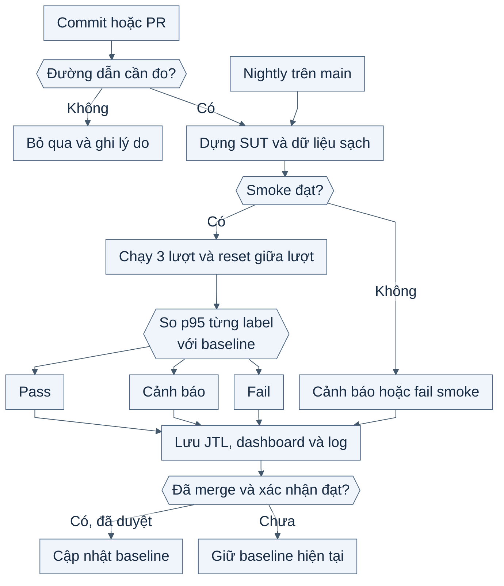

# Task 3 - Đề xuất Continuous Performance Testing

Thiết kế áp dụng cho REST API EShop theo workflow Login → Search products → Product detail → Add to cart → Checkout. Các số liệu hiệu chỉnh lấy từ T04 và T05 trên máy `GOYOONJUNG`, nơi Node và JMeter chạy chung. Thiết kế và dung sai dưới đây chưa được kiểm chứng trên CI runner. [Môi trường](Environment.md) · [T04](T04_Execution.md) · [T05](T05_Endurance.md)

## 1. Theo dõi commit và chọn lượt chạy

Khi mở, cập nhật hoặc mở lại PR vào `main`, lấy danh sách thay đổi giữa merge base và HEAD của PR. Đo mã ứng viên trên commit ghép với `main` nếu có, ghi SHA của commit thực chạy. Với push lên `main`, xét toàn bộ diff từ SHA trước push đến SHA mới, kể cả push nhiều commit. Tính cả đường dẫn cũ và mới khi đổi tên, cả tệp bị xóa. Thay đổi khớp nhiều nhóm thì áp dụng nhóm cần đo. Nếu thiếu merge base hoặc chưa biết tệp ảnh hưởng thế nào, chạy smoke và đánh dấu cần rà soát trước khi bỏ qua.

| Đường dẫn thay đổi | Quyết định và căn cứ |
| --- | --- |
| `backend/**` | Chạy. [server.js](../backend/server.js) phục vụ route, JWT và giỏ trong RAM. [database.js](../backend/database.js) chứa schema và seed. `backend/package.json`, `backend/package-lock.json` và công cụ schema, migration hoặc seed thêm sau này cũng kích hoạt. Thay đổi `backend/database.sqlite` kích hoạt kiểm tra nguồn seed. Khi đo, khởi tạo DB mới từ mã của revision đang kiểm tra để tránh dùng lại đơn, giỏ hoặc lockout cũ. |
| `hw05/plans/**`, `hw05/data/**` | Chạy smoke sau mọi thay đổi JMX, CSV và script provision. Đo lặp profile bị ảnh hưởng. Nếu chỉ đổi profile tải nặng, chạy smoke trên PR và đo profile đó vào lịch đêm hoặc kích hoạt thủ công trước merge nếu cần xác minh thay đổi. Khi đổi workload, CSV hay assertion, tạo định danh profile mới để kiểm tra tính so sánh của baseline. [Plans](plans/) · [CSV và script provision](data/) |
| Cấu hình chạy SUT hoặc phép đo | Chạy khi thay Node, JRE, JMeter, tham số heap, image hoặc loại runner, hay đổi cổng, proxy, cấu hình SQLite, setup hoặc workflow perf. `run_servers.sh` đưa vào diện kiểm tra nếu đổi cách khởi động backend. Nếu sau này thêm manifest/lockfile ở root, cấu hình container hoặc workflow dùng chung, xét theo thành phần sử dụng chúng. Repo hiện tách manifest và lockfile theo ứng dụng. [Script khởi động hiện có](../run_servers.sh) |
| `frontend-web/**`, `frontend-admin/**`, `frontend-mobile/**` | Bỏ qua phép đo API nếu chỉ đổi giao diện, asset, cấu hình build hoặc dependency client. JMeter gọi API trực tiếp trên backend. Nếu client đổi endpoint, payload hoặc số lần gọi API trong một luồng, gắn cờ rà soát độ đại diện của JMX và CSV. Ví dụ, khi [Checkout.jsx](../frontend-web/src/pages/Checkout.jsx) hoặc [App.js của mobile](../frontend-mobile/App.js) đổi cách gọi checkout, đối chiếu workflow rồi chạy profile đã cập nhật nếu cần. |
| `README.md`, `**/README.md`, `docs/**`, `hw05/*.md`, `hw05/ai/**`, `hw05/results/**`, `hw05/evidence/**` | Bỏ qua chỉnh sửa trình bày, hồ sơ và kết quả. Tệp trong những thư mục này mà job thực sự dùng để dựng dữ liệu, chạy tải hoặc chấm p95 vẫn kích hoạt. Với [đặc tả API](../api_specification.md) hoặc [hướng dẫn cài đặt](../setup_guide.md), đổi câu chữ thì bỏ qua. Đổi hợp đồng API hoặc giá trị vận hành thì rà soát plan và cấu hình trước. |
| Test chức năng độc lập, ví dụ `backend/test_profile.js` | Bỏ qua nếu thay đổi chỉ thuộc test Profile và tệp không được job perf gọi. Helper dùng chung cho smoke, fixture hay đọc JTL vẫn kích hoạt. |

PR phù hợp chạy smoke **2 VU, 30 giây, ramp 5 giây** bằng override của Load plan để xác nhận đủ năm request và assertion. Nếu hợp lệ, chạy **3 lượt Load** tuần tự với cấu hình T04, **6 VU, 150 giây gồm ramp 30 giây, think-time 1–2 giây**. Lịch đêm chạy trên SHA đã merge, có thể bỏ qua nếu SHA, cấu hình và dữ liệu trùng lượt nightly hợp lệ trước đó. Dành lịch đêm cho Stress và Endurance, thêm Spike khi cần kiểm hồi phục. Kết quả chỉ có ý nghĩa trong profile được ghi nhận. [Tham số Load](Load_Plan.md) · [Stress và Spike](Stress_Spike_Plans.md) · [Endurance](T05_Endurance.md)

Mỗi lượt, kể cả giữa smoke và đo, dùng thư mục và SQLite riêng, cài backend bằng lockfile, khởi động process Node mới, chờ seed sẵn sàng rồi provision tài khoản giả từ CSV. Đối chiếu số dòng credentials hợp lệ, số tài khoản đã tạo, sản phẩm, số đơn bằng 0 và tài khoản chưa khóa. Dùng một dòng credentials mới cho mỗi vòng, tắt recycle. Ước tính theo thời lượng, VU và think-time tối thiểu của profile. Ví dụ Load cấp ít nhất `6 × (ceil(150 / 4,6) + 1) = 204` tài khoản theo công thức T02, và Endurance T05 cấp 7.500 cho cả ramp lẫn pha giữ. Smoke chỉ xác nhận harness và hợp đồng API. Lượt đo giữ nguyên bộ dữ liệu, giá trị tham số và thứ tự các label giữa ứng viên và baseline. [Tính credentials](Load_Plan.md) · [Reset và đối chiếu SQLite](T04_Execution.md) · [Số lượng Endurance](T05_Endurance.md)

## 2. Hiệu chỉnh cờ p95 từ kết quả local

Tính p95 cho từng `label` từ `elapsed` (ms), nội suy tuyến tính tại hạng `0,95 × (n+1)` trong dãy sắp xếp, chặn ở hai đầu. Đối chiếu tất cả lượt Load và Stress với `pct2ResTime` trong `statistics.json` của chính lượt đó. Tính **biên độ = max(p95) − min(p95)** giữa các lượt hoặc cửa sổ trong cùng nhóm. **Biên độ % = 100 × biên độ / median(p95)** của nhóm. Tính trước khi làm tròn. Phần trăm này mô tả biên độ quan sát, chưa phải xác suất báo động giả.

| Nhóm và thứ tự trong mỗi ô | Login | Search products | Product detail | Add to cart | Checkout |
| --- | --- | --- | --- | --- | --- |
| Load T04 toàn lượt. 00:55, 01:12 | 4 / 4 | 3 / 3 | 3 / 3 | 2 / 2 | 13,55 / 10 |
| Biên độ Load (ms) | 0 | 0 | 0 | 0 | **3,55** |
| Stress T04 toàn lượt. 01:23, 01:30, 01:55 | 10 / 9 / 9 | 8 / 8 / 9 | 9 / 9 / 9 | 2 / 2 / 2 | 15 / 14 / 14 |
| Biên độ Stress toàn lượt (ms) | 1 | 1 | 0 | 0 | 1 |
| Stress T04 bậc 144 VU, giây `[94,108)`, cùng thứ tự lượt | 13 / 11 / 11 | 9 / 12 / 11 | 9 / 12 / 11,30 | 3 / 3,30 / 3 | 16 / 17 / 15 |
| Biên độ Stress 144 VU (ms) | 2 | **3** | **3** | 0,30 | 2 |
| Endurance T05. Năm cửa sổ 180 giây liền nhau sau ramp | 3 / 3 / 3 / 2 / 3 | 3 / 2 / 2 / 2 / 2 | 3 / 2 / 2 / 2 / 2 | 2 / 2 / 1 / 1 / 1 | 11 / 10 / 10,80 / 10 / 10 |
| Biên độ Endurance (ms) | 1 | 1 | 1 | 1 | 1 |

Mỗi dãy trong bảng ghi p95 theo ms. Thời gian lượt chạy theo UTC+7 ngày 19/11/2026. Load có **550 và 548 mẫu**. Checkout lệch **3,55 ms (30,15%)**, trong khi p95 gộp đều là 9 ms. Stress có **20.246, 20.224 và 20.203 mẫu**. p95 gộp đều là 10 ms. Biên độ theo label lớn nhất toàn lượt là **1 ms**, cao nhất theo tỷ lệ là Search **12,50%**. Ở bậc 144 VU riêng, Search lệch **3 ms (27,27%)** và Detail lệch **3 ms (26,55%)**. Lấy request theo `timeStamp` bắt đầu trong `[94,108)` so với mốc `run.t0_epoch_ms` của mỗi lượt và kiểm tra `allThreads = 144`. [Lịch sử các lượt T04](T04_Execution.md) · [JTL Load dùng để nộp](results/23120410_Load_20261119.jtl) · [JTL Stress dùng để nộp](results/23120410_Stress_20261119.jtl)

Endurance lệch tối đa **1 ms** theo label giữa các cửa sổ `[20,200)`, `[200,380)`, `[380,560)`, `[560,740)`, `[740,920)`. Giỏ hàng có biên độ tương đối **100%** vì median chỉ 1 ms. Đây là biến động trong cùng một lượt khi DB và giỏ hàng tích lũy, nên không coi năm cửa sổ là năm lượt chạy độc lập. Load và Stress cũng chỉ có hai và ba lượt trên cùng một máy. [JTL Endurance](results/23120410_Endurance_20261119.jtl) · [Số liệu cửa sổ T05](evidence/t05/endurance-verification.json)

Chạy từ root repo với Python 3.10+.

```powershell
python hw05/evidence/t07/recompute_noise.py
```

Để tính đủ bảng, cần JTL và `statistics.json` của lượt Load cũ và hai lượt Stress cũ trong `../.runtime/T04`, cùng `evidence/stress-verification.json` của hai lượt Stress để lấy mốc `t0_epoch_ms`. Thư mục này nằm ngoài Git. JTL, dashboard và file xác minh của các lượt được chọn cùng dữ liệu Endurance nằm trong repo. [Script tái tính](evidence/t07/recompute_noise.py) · [Lịch sử các lượt T04](T04_Execution.md)

## 3. Baseline và quy tắc quyết định

- **Khởi tạo trên runner sẽ dùng để đo.** Chọn commit đã duyệt trên `main`, chạy 5 lượt hợp lệ tuần tự cho mỗi profile. Baseline `B` là trung vị của năm giá trị p95 riêng cho từng label. Với Stress ghi cả toàn lượt và cửa sổ 144 VU `[94,108)`. Với Endurance so từng cửa sổ 3 phút với cửa sổ tương ứng, theo dõi thêm RPS, lỗi, RAM và độ dốc working set như T05. Các giá trị local ở mục 2 dùng để chọn dung sai ban đầu.
- **Lưu baseline có phiên bản.** Đề xuất lưu `perf-baseline.json` và JTL tham chiếu như artifact của job baseline trên `main`. Lưu bản đã duyệt dài hạn theo profile trong kho artifact của dự án để các PR đọc được qua ID. Metadata gồm SHA mã nguồn, định danh/hash plan và fixture, phiên bản công cụ và Node, loại runner, thiết lập CPU/RAM và cách bố trí Node/JMeter, khoảng đo, số mẫu và ID các run gốc. Cố định khóa của baseline trước khi đo ứng viên. Khi đổi runner hoặc profile, đo lại mốc trên `main` với cùng cấu hình rồi mới áp dụng gate.
- **So trung vị của ba lượt.** Với từng label và khoảng đo, tính p95 mỗi lượt rồi lấy trung vị `C`. Phép đo cần đầy đủ 5 label và ít nhất 100 mẫu cho mỗi label trong khoảng so sánh của từng lượt. Yêu cầu run kết thúc đúng lịch, JTL đủ cột, đạt assertion và fixture đối chiếu được. Lưu cả số sample và RPS để phát hiện thiếu tải. Điều tra mức RPS dưới 90% mốc cùng profile kể cả khi latency đạt.
- **Dung sai đề xuất.** Báo vượt ngưỡng khi `p95 − B > max(4 ms, 0,25 × B)`. Sàn **4 ms** cao hơn biên độ local lớn nhất **3,55 ms** và tránh biến động 1 ms trên label rất nhanh thành cảnh báo lớn. Phần **25%** nới dung sai cho label có p95 cao hơn 16 ms. Ví dụ `B = 10 ms` cho giới hạn 14 ms, `B = 20 ms` cho giới hạn 25 ms. Nếu số đo đối chứng runner còn vượt dung sai này, ưu tiên giảm nhiễu và hiệu chỉnh lại trước khi bật chặn merge.
- **Pass, cảnh báo, fail.** Pass khi đủ ba lượt hợp lệ, từng label đều trong dung sai ở cả ba lượt và không có vấn đề về tải hoặc tính đúng. Cảnh báo khi chỉ một lượt vượt ngưỡng ở một label, hoặc khi thiếu baseline tương thích, thiếu mẫu, RPS suy giảm hay có dấu hiệu nhiễu runner/fixture. Giữ dữ liệu và điều tra các lượt cảnh báo. Chỉ thay lượt lỗi hạ tầng theo nguyên nhân ghi nhận trước khi xét p95, tối đa một lần rồi báo kết quả thiếu dữ liệu nếu vẫn thất bại. Fail p95 khi `C` vượt ngưỡng ở ít nhất một label/khoảng đo với ba lượt hợp lệ, tức ít nhất hai trong ba lượt vượt ở cùng label/khoảng đó. Lỗi API hoặc assertion tái hiện với fixture hợp lệ là lỗi chức năng riêng. Kiểm tra môi trường trước khi gán lỗi setup/EOF/lockout cho backend.
- **Sau merge.** Chạy xác nhận lại trên SHA đã merge và giữ lịch sử artifacts. Chỉ tạo bản baseline mới khi bộ đo trên `main` đạt, có phê duyệt và đã kiểm tra với mốc chuẩn được duyệt để tránh nhiều lần tăng nhẹ che khuất regression tích lũy. Lần cập nhật dùng lại quy trình 5 lượt. Giữ baseline trước đó và mã lý do thay mốc. Cảnh báo, fail và thay đổi thiếu dữ liệu giữ nguyên baseline.

## 4. Sơ đồ luồng



[Bản PNG của sơ đồ để chèn PDF](Continuous_Perf_Testing_Flow.png). Đã kiểm tra bản in thử trên một trang PDF A4 dọc. Ảnh rộng 170 mm, cao khoảng 197 mm, các nhãn và đường nối đọc được.

Lượt hỏng hoặc bị dừng vẫn lưu JTL phần chạy được, log và lý do dừng. Tạo dashboard từ từng JTL khi có đủ dữ liệu. Khi chưa phát tải, lưu log chuẩn bị và danh sách artifact chưa sinh.

## 5. Chi phí, đánh đổi và giới hạn

| Đánh đổi | Cách xử lý trong đề xuất |
| --- | --- |
| Thời gian và chi phí CI | Smoke và 3 lượt Load mất khoảng **8 phút thời gian phát tải**. Nightly chạy 3 Stress × 120 giây và 3 Endurance × 920 giây mất **52 phút phát tải**, chưa kể cài đặt, reset, provision, xuất dashboard và upload. Một đợt Spike lặp ba lần thêm 7 phút 30 giây. Dùng smoke để phản hồi nhanh, giữ tải nặng vào ban đêm và chỉ chạy lại khi có thay đổi hoặc cần đối chứng. Giữ artifact của các lượt cảnh báo/fail và các mốc baseline để điều tra. |
| Runner chia sẻ gây báo động giả | Lặp tuần tự, so trung vị và dùng dung sai có sàn ms. Cố định loại runner, khóa để tránh hai job perf dùng cùng tài nguyên, thu CPU/RAM và kiểm tra nhiễu host. Có thể chạy Load bằng chế độ cảnh báo trước, rồi bật gate sau khi có đủ lượt đối chứng. Sự cố lặp qua nhiều lần do cùng một runner quá tải vẫn có thể làm sai cả trung vị. |
| JMeter và SUT chạy chung máy | T03 giới hạn Stress ở 144 VU theo RAM khả dụng và T05 có hai pilot dừng do RAM. Dùng CLI non-GUI và đo tài nguyên của cả hai process. Nếu tách máy phát tải và SUT cho nightly, lấy baseline mới vì overhead mạng và cách chia tài nguyên thay đổi. [T03](Stress_Spike_Plans.md) · [T05](T05_Endurance.md) |
| Tài khoản, lockout và dữ liệu thay đổi giữa lượt | T02 cấp một tài khoản cho mỗi vòng. T04 và T05 khởi động Node mới để dọn giỏ trong RAM, dựng SQLite sạch và provision lại để số đơn và trạng thái khóa bắt đầu giống nhau. EOF, lỗi seed hoặc lockout do fixture có thể làm VU giảm hoặc request lỗi nhanh, khiến p95 không đại diện cho tải dự kiến. Đối chiếu sample theo label, VU thực, RPS và số đơn trước khi dùng kết quả. [T02](Load_Plan.md) · [T04](T04_Execution.md) · [T05](T05_Endurance.md) |
| Độ nhạy và phạm vi | Sàn 4 ms có thể bỏ sót regression nhỏ ở các endpoint rất nhanh, median che khuất một lượt xấu và p95 che khuất đỉnh ngắn. Giữ JTL, p99, số lỗi và các cửa sổ theo pha khi điều tra. Load 6 VU có thể bỏ sót tranh chấp chỉ xuất hiện khi Stress. Nightly phát hiện các vấn đề đó muộn hơn PR. Dữ liệu seed nhỏ, môi trường local và phép đo Endurance 15 phút giới hạn khả năng suy rộng sang production. |
